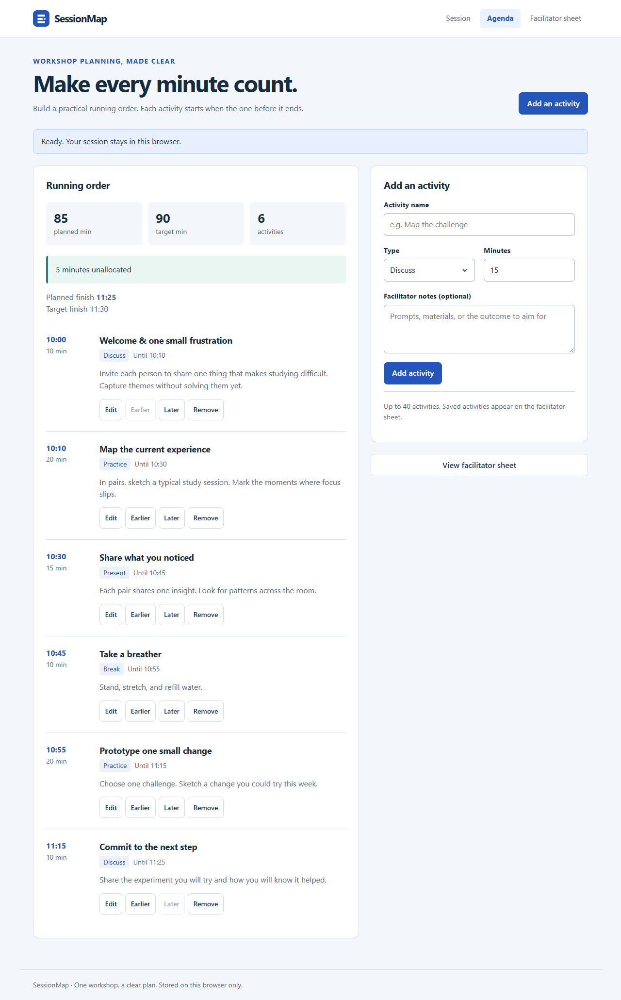

# SessionMap

A browser-local workshop agenda planner for educators and facilitators. Build a
running order, check whether it fits, and print a sheet with times and notes.



## Run locally

Requires Node.js 22 or later. No runtime dependencies, account, API key or environment
variables are needed. From this folder:

```sh
node scripts/serve.mjs
```

Open http://127.0.0.1:4191. Use HTTP localhost (or HTTPS when hosted), rather than
opening HTML files directly: JavaScript modules and browser storage need an origin.

1. On **Session**, enter a title, start time and target length, then save.
2. On **Agenda**, add activities with durations, types and optional notes. Use
   **Edit**, **Earlier**, **Later** and **Remove** to refine the running order.
3. Check planned minutes and the remaining/over-target message.
4. Open **Facilitator sheet** and print from the button or browser print command.
5. Download a backup from **Session** before clearing browser data or switching devices.

**Load synthetic example** provides a fictional 90-minute workshop with 85 planned
minutes. It asks before replacing your session. There is no real participant data.

## Data and validation

- One session per browser origin, stored under `sessionmap.v1` in localStorage.
  Explicit saves persist details and activities; unsaved form edits are not retained
  when you navigate. Nothing is uploaded and there are no remote assets or analytics.
- Session title and activity names: 1–100 characters. Notes: up to 2,000 characters.
  Target: 5–480 minutes. Each activity: 1–240 whole minutes; up to 40 activities.
- Types: Discuss, Practice, Present, Break. Times use a 24-hour clock. `( +1d )`
  (shown without spaces) marks the following day. There is no date/time-zone or DST calculation.
- The agenda is sequential: no parallel activities, gaps, live timer or automatic
  shortening. Unallocated time is breathing room; an overrun is a warning, not a save error.
- JSON backups include version 1, session details and activities. Imports are limited
  to 400,000 UTF-8 bytes and validated before confirmation or storage. Recognized fields
  are retained; unknown fields are discarded. Invalid imports leave saved data untouched.
- If saved data is damaged, editing is blocked until recovery. **Download stored data**
  retrieves the original text; restoring a valid backup or loading the demo explicitly
  replaces it. Storage permission/quota failures are visible and do not claim success.
- A stale tab cannot silently save over newer data. Reload it to use the latest saved
  session. This is a best-effort single-browser safeguard, not collaborative editing.
- Backups contain your titles and notes. Review them before sharing. Browser data can
  be cleared or unavailable in private mode; keep a downloaded copy of important work.

## Verify and build

```sh
npm ci
npm test
npm run lint
npm run build
npm run test:e2e
```

Local browser tests use an installed Microsoft Edge. For other systems, install
Chromium with `npx playwright install --with-deps chromium` and run the tests with
the `CI=1` environment variable set (PowerShell: `$env:CI='1'`). Playwright is a
development-only dependency. Node unit tests, lint and build do not need it.

The build copies nine public assets into `dist/`. Static hosting should publish that
directory; routes are `index.html`, `agenda.html` and `sheet.html`. The repository has
no production deployment configured yet. CI checks pushes and PRs on Node 22/Linux.
Do not deploy the setup-only main branch before the implementation is merged.

Current local results: **8 unit tests, 9 browser tests, lint and build pass**. Browser
tests cover the main journey, backups, storage failure, corrupt-data recovery,
cross-tab conflicts, keyboard access, print-media visibility and 1280/390/320px layouts.
See [verification details](docs/VERIFICATION.md), [mobile](docs/mobile.png) and
[print-media screenshot](docs/print.png). Physical printing and PDF pagination were
not tested; test coverage is Edge locally and Chromium in CI, not Safari/Firefox.

To regenerate synthetic screenshots after building: `node scripts/capture.mjs`.
This starts and stops its own preview server on port 4191.

## Design decisions and limitations

Plain HTML/CSS/JavaScript keeps the product inspectable and cheap to host. Pure timing
and validation functions are separate from the DOM. Semantic forms, visible focus,
keyboard reorder controls and a jump to the activity editor keep the workflow usable
on small screens. Notes are rendered as escaped text. Print styles remove navigation
and controls and keep each activity together when possible.

No cloud sync, authentication, multi-session library, calendar integration or AI.
No service worker: the app does not promise reloads without its local/static server.
No `.env.example` is necessary because the app has no secrets or configurable services.

## Implementation milestones
1. Working static-project setup.
2. Brief and acceptance criteria; draft PR before implementation.
3. Validated timing model and boundary tests.
4. Versioned local storage with recoverable failure handling.
5. Responsive multi-page shell and identity.
6. Session details editor and timing summary.
7. Activity creation and agenda rendering.
8. Editing, reordering and confirmed removal.
9. Facilitator sheet and print styles.
10. JSON backup, safe import and synthetic demo.
11. Journey checks, CI and build verification.
12. Browser QA, documentation and ready-for-review handoff.
